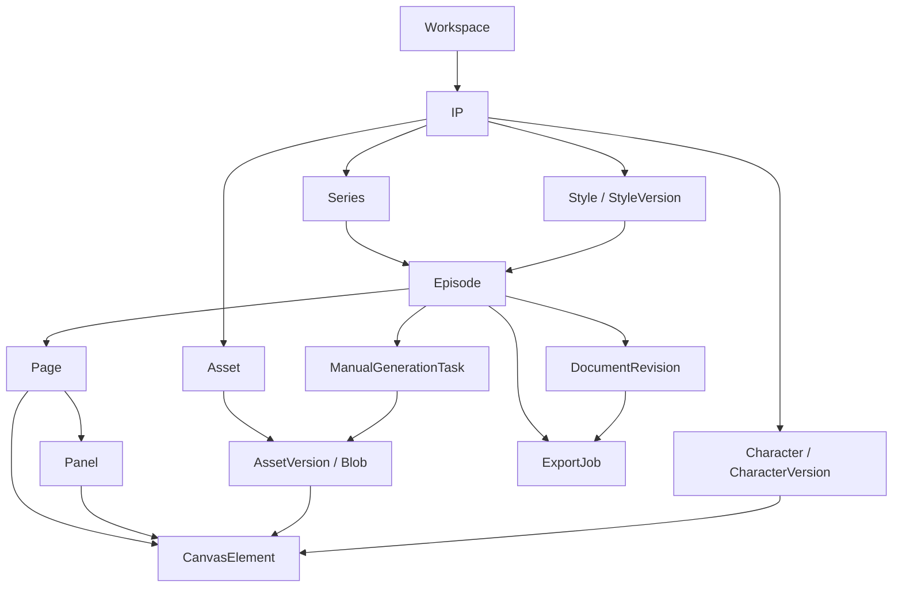

# IP Studio — 产品需求文档（PRD）V1.0 · 最终开发基线

> **版本**：V1.0 / 开发基线  
> **日期**：2026-10-14  
> **工作名称**：IP Studio — 多 IP 数字资产管理与 PPT 式漫画编辑平台  
> **产品形态**：自托管 Web 应用，桌面浏览器优先  
> **第一版生产方式**：先验证本机 Codex 原生 ImageGen；可用则自动生图入库，不可用则在线 ChatGPT 人工生图/粘贴/导入；IP Studio 始终负责管理、编辑、排版、存档、导出  
> **目标案例**：《人间卡顿局》EP01–EP06 重建为结构化可编辑漫画工程

---

## 0. 决策摘要（开发前必须读）

### 0.1 一句话定义

IP Studio V1 不是 AI 生图平台，也不是自动发帖平台，而是一个围绕原创 IP 的 **长期数字资产库 + 结构化剧本/分镜 + PPT 式图层漫画编辑器**。

### 0.2 最重要的产品决策

1. **双路径生图**。优先探测本机 Codex 原生 ImageGen 是否实际可运行（包括 App Server/本地 Bridge），可用时自动保存 PNG 入库；不可用时在线 ChatGPT 手动生图、粘贴或导入。禁止调用网页私有 API/Cookie/浏览器机器人，不将 Plus 额度冒充 API 权限。
2. **ChatGPT 图片是位图**。Image Gen 输出的图片不因导入 IP Studio 而变成可修改人物五官、线条、笔触的原生矢量/PPT 图层。V1 的“可编辑”指：**文本、气泡、聊天消息、独立图片素材、蒙版/裁切、形状、位置、大小、层序、画格/页面布局**。已经画死在一张图里的内容不能承诺自动分离。
3. **采用混合漫画生产**：无字完整分镜作为底图；可复用角色透明图/道具独立成层；所有新台词和聊天组件由编辑器绘制。重复场景优先分层合成，复杂镜头优先无字完整图片。
4. **先资产与模板，再创作自动化**。Character Bible、Style Bible、BrandTemplate/TemplateVersion、资产版本与引用锁是第一优先级；模板外壳固定，标题与内容动态。
5. **工程文件是唯一可持续编辑的权威源**：保存结构化 JSON + 原始素材；PNG/JPG 为渲染输出；PPTX 为可部分编辑的交换格式，**不是**主工程格式。
6. **第一版仍支持多个 IP**，但只做 **单工作室/单管理员用户** 的管理；多账号运营、多人协作和多租户 SaaS 以后做，不阻塞 V1。
7. **正式资产不可覆写**：已批准的角色、画风、背景版本一经用于作品必须固定引用；更新必须创建新版本。
8. **本地 Codex 最小权限**。Codex 不直接覆写数据库或锁定资产，统一通过可预览、可验证、需批准的编辑 Patch。
9. **现有六期只是视觉验证材料**。扁平旧图片可导入为“参考图/底图”，不等于能无损逆向拆成所有层。优先用 EP01 或 EP02 验证“无字分镜 + 可编辑对白”的新工作流。

### 0.3 第一版交付成功的定义

无需写代码，用户能从零完成以下闭环：

> 创建 IP → 锁定角色/画风 → 新建系列与分集 → 编写剧本/分镜 → 由 IP Studio 调用已验证的本机 Codex ImageGen 或使用在线 ChatGPT 人工生图 → 图片自动/人工导入素材库 → 在可视化画布上逐层编辑 → 保存版本 → 导出小红书图文与可编辑 PPTX → 下次继续打开修改。

---

## 1. 用户与目标

### 1.1 核心用户

- **IP 主理人（V1 唯一必备账号）**：孵化多个 IP，定义角色与画风，管理资产、创作期数和成品。
- **创作者/编辑（同一人兼任）**：整理剧本、使用 ChatGPT 外部生图，在 IP Studio 制作页面。
- **协作编辑（未来）**：拥有独立账号和审核角色；V1 不提供完整协作权限。

### 1.2 MVP 用户故事

| ID | 用户故事 | 验收成果 |
|---|---|---|
| US-01 | 我可以维护 3 个互不干扰的 IP | 独立的角色、场景、画风、作品和素材检索 |
| US-02 | 我可以把卡仔固定为角色 V1.0 | 保存角色规范、封面图、正侧背图及表情图片，引用稳定 |
| US-03 | 我能对某个分镜生成 ChatGPT 生图任务说明 | 一键复制任务提示词、下载所需参考图片 ZIP |
| US-04 | 我从 ChatGPT 下载图片后可拖拽到 IP Studio | 图片入库、归属分镜、来源记录且可在画布引用 |
| US-05 | 我能在一张漫画页里像 PPT 一样编辑 | 图层选择、拖动缩放、复制粘贴、文本气泡、撤销重做 |
| US-06 | “不在。”的消息不会再跑到错误一侧 | 由 `sender` 字段控制左右，不能通过生图决定方向 |
| US-07 | 我只想换一格的图片或一行文字 | 只影响该层/该格，其他页保持不变 |
| US-08 | 修改角色版本后不破坏已经定稿的作品 | 作品引用具体 `character_version_id`，可查看来源 |
| US-09 | 我能备份或迁移漫画工程 | ZIP 含 JSON 工程和全部依赖素材；导入后仍可编辑 |
| US-10 | 我能导出可人工继续修改的 PPT | PPTX 中文字、气泡、形状、独立图片都是单独可选对象 |

### 1.3 最小验收样例

- 工作室内创建 **至少 3 个 IP**，每个 IP 具有专属 Style Bible 和 3 个角色。
- 《人间卡顿局》至少 **2 期漫画**从素材/无字分镜完成结构化重建（EP01 必须含聊天消息左右判断案例）。
- 单期可创建 **至少 10 页**、每页多个画格与图层。
- 对 EP01 更改文字、镜头底图、角色素材与画格布局，均无需重做整期。
- 导出 PNG 图组、JSON 工程包、PPTX，并用目标软件打开确认内容没有丢失。

---

## 2. 范围与优先级

### 2.1 必做范围（P0，V1 交付门槛）

1. IP 档案 / Series / Episode / Page / Panel 的基础管理。
2. 角色 Bible、画风 Bible、背景/场景、道具等数字资产和版本管理。
3. 用户本地图片批量导入、拖拽、粘贴、关联分镜、预览、下载、标签检索。
4. **Codex/ChatGPT 双路径生图任务卡**：环境自检、本机生成、自动入库；未通过自检时复制提示词、参考图包并人工导入。
5. **固定 IP 品牌模板 + 布局模板**：外层底色/Logo/标题样式/装饰/页脚锁定；标题文字、EP 编号、画格内容动态；4/6/8 格与自定义布局。
6. PPT 式漫画编辑器：多页、画格、图片图层、文字、气泡、聊天消息、常见形状、对齐、撤销重做、层级与锁定、裁切。
7. 可编辑工程保存、手动版本快照、自动保存、ZIP 工程备份与恢复。
8. 导出高清 PNG 图组、可编辑分层 PPTX（下文说明边界）。
9. 本地/服务端文件安全管理、单管理员登录、关键数据校验与测试。

### 2.2 优化范围（P1，V1 验收后）

- 批量替换角色或文本样式（**品牌模板和 4/6/8 格布局模板为 P0 必做**）。
- 更多图像调整：滤镜、局部遮罩画笔、背景移除（**不保证质量**）、智能裁边。
- 角色资产版本的可视化对比、作品一致性检查清单和引用统计。
- 历史扁平漫画的辅助拆格工具（裁切为“多张扁平画格”；并不能逆向恢复人物/文字图层）。
- 更高级的 PPTX 层映射、可编辑气泡尾巴、跨平台字体一致性校验。

### 2.3 明确不做（V1）

- 付费图像 API、MiniMax 视频、ComfyUI、本地模型训练。**本机 Codex 原生 ImageGen 为条件式 V1 集成，不是假定可用的付费 API 自动化。**
- 自动登录 ChatGPT、浏览器机器人、爬取 ChatGPT 的对话/图片、Cookie 管理。
- 小红书自动发布、账号密码管理、互动增长、爬虫或账号矩阵运营。
- 多用户实时协同编辑、审批工作流、租户账单。
- 通用 Photoshop/Krita 级像素绘画、骨骼动画、真实的“AI 逐笔可编辑”输出。
- 完整 PPTX 导入后高保真还原为项目（V1 仅 **导出**）；任意第三方 PPTX 可无损往返不做承诺。

---

## 3. 信息架构、页面与路由

```text
IP Studio
├─ /dashboard                     工作台：最近作品 / 最近资产 / 待办
├─ /ips                           IP 列表：搜索、新建、归档
│  └─ /ips/:ipId                  IP 工作区
│     ├─ overview                 IP 档案与世界观
│     ├─ characters               角色列表与角色 Bible
│     ├─ styles                   画风 Bible 与版本
│     ├─ scenes                   场景、背景、道具
│     └─ assets                   IP 内资产库
├─ /assets                        全局素材检索、共享与来源
├─ /series                        系列列表
│  └─ /series/:seriesId
│     └─ /episodes/:episodeId     剧本/页面/生图任务
├─ /editor/:episodeId             漫画编辑器（核心）
├─ /ips/:ipId/brand              IP 品牌模板版本管理/编辑
├─ /templates                     4/6/8 格布局、气泡/聊天组件
├─ /codex                         本地连接、能力自测、任务日志
├─ /exports                       导出任务与文件
└─ /settings                      存储、备份、画板默认值、字体、账户
```

### 3.1 Dashboard（P0）

- 最近使用的 IP / 分集 / 资产、最近编辑时间。
- 今日待处理：缺少图像的画格、待审核候选资产、未导出的定稿作品。
- 主操作：**新建 IP**、**新建分集**、**继续编辑**。
- V1 不展示虚构的账号数据、曝光增长 KPI 或 AI 生成成本；可显示人工登记的生图次数/图片数。

### 3.2 IP 中心（P0）

**IP 信息**：名称、简介、受众、题材、视觉关键词、世界观、角色关系、版权归属、创建时间、状态。

**角色 Bible**：角色 ID、名字、性格、语言风格、固定外观描述、不可变化特征、主色板、禁忌特征、标准参考图、表情/动作/服装资源、版本状态。

**Style Bible**：画风名称、线稿规则、配色、光影、材质、画幅/比例、正向与负向规范、示例参考图、字体/气泡规范、版本状态。

- 支持“**候选版本 → 批准锁定版本 → 从锁定版派生新候选**”。
- 已批准版本的描述、色值和参考素材内容不允许原位修改；允许变更描述性标签但应记录审计。
- 跨 IP 使用素材必须通过“**链接为共享资产**”，保留原始归属与许可说明，而不是复制后丢失来源。
- 每个 IP 都可以设置 `default_style_version_id`，作品记录明确的冻结版本。

### 3.3 资产中心（P0）

资产分类：`character_reference`、`character_pose`、`expression`、`scene`、`background`、`prop`、`composite_panel`、`texture`、`other`。

列表支持：网格/表格切换；按 IP、角色、画风、类型、状态、标签、尺寸、文件格式、来源筛选。

资产详情必须可见：

- 文件名、预览、尺寸、比例、大小、是否透明、原始 SHA-256。
- 来源类型：`chatgpt_web` / `uploaded` / `edited_locally` / `other`；可选备注、生成日期、参考图、提示词快照。
- 用途与归属：所属 IP、关联角色、场景、分镜、版本。
- 状态：`candidate` / `approved` / `archived`；已引用资源不可彻底删除（除非先解除依赖并有明确确认）。
- **新增版本**而非直接“替换原文件”；作品内可以显式“更新引用到新版本”，且更新前展示受影响画格数。

V1 导入支持 PNG、JPG/JPEG、WebP；优先支持透明 PNG。限制：默认单文件 <= 25 MB，尺寸上限作为可配置项；无法解析则报错且不入库。SVG 若启用则需安全净化，默认不开放任意外部 SVG 上传。

### 3.4 系列与分集（P0）

- IP → Series → Episode；同一 Episode 可有多页，每页多个 Panel。
- 分集字段：编号、标题、主题标签、概要、状态（draft/editing/ready/exported）、剧本版本、默认尺寸、关联画风版本。
- 剧本允许**人工输入、粘贴 Markdown、编辑结构化场景**；AI 自动写剧本不是 V1 必需。
- 场景 Scene 包含出场角色、地点、时间、剧情动作、对白列表；可以转换为待绘制的 Panel 卡片。
- 画格 Panel 包含角色引用、背景引用、镜头类型、无字绘图说明、台词/消息以及图片候选池。
- **剧本和画面不是同一个字段**；修改剧本文字时，用户可以选择是否同步到已经布置的画格文本层。

### 3.5 生图任务卡（P0）

任务模式为 `codex_native`、`chatgpt_web` 或 `asset_only`；必须做 Codex 能力探测并公开实际状态，不能仅凭 Skill 文件存在就宣称可用。下面是 **人工回退流程**：

1. 在分镜卡选择角色版本、画风版本、背景版本与需要的镜头动作。
2. 生成**无字画面提示词**（有文字展示需要时，优先独立留白，并提示不可在图内直接渲染中文）。
3. 展示参考图清单：角色官方参考、Style Bible 样例、固定场景、动作参考；一键打包为 ZIP。
4. **复制提示词**，可点击打开 ChatGPT 网站（不能保证自动带入文本/附件）。
5. 用户在 ChatGPT 中手动上传参考图、生成、挑选、下载图片。
6. 回到 IP Studio **粘贴/拖拽/选择文件**，关联对应生图任务与分镜。
7. 保存候选、人工检查、批准后使用；来源为 `chatgpt_web`。

人工任务状态：`prepared` → `waiting_manual_generation` → `asset_imported` → `accepted` / `rejected`；Codex 任务为 `queued` → `running` → `candidate_ready` → `accepted` / `rejected` / `failed`。进度必须来自真实事件。可选手填生成轮次、备注、原因；不统计不存在的 API Token/费用。

#### 3.5.1 提示词模板（数据字段）

```text
【身份】你是《人间卡顿局》的漫画美术。
【任务】为 EP01 的 P03 生成单张 3:4 / 指定比例的无字漫画画面。
【角色锁定】角色 CHAR-001 @v1.0，必须参考附件 [A] 的轮廓、颜色和五官关系。
【画风锁定】STYLE-001 @v1.0，参考附件 [B] 的线稿、光影和饱和度。
【场景】背景 ROOM-001 @v1.0，参考附件 [C]；允许根据镜头角度调整透视，不改变关键陈设。
【镜头/动作】卡仔坐在沙发上，盯着手机，先疑惑后震惊，中近景。
【构图】角色位于偏左，顶部及右侧预留后续放聊天气泡的干净空间。
【禁止】禁止任何中文/英文字符、数字、聊天框、标志、页码、水印；禁止改变角色耳朵形状。
【输出】只输出单张无字画面，不要多格拼贴，不需要漫画边框。
```

上述附件字母仅是系统生成的参考顺序提示，不是 ChatGPT 网站稳定的内部文件编号。预览包含“需人工核对参考图是否上传正确”。

---

## 4. 漫画编辑器：V1 的主产品

### 4.1 交互与页面布局

```text
┌ 顶栏：作品名称 | 已保存状态 | 撤销/重做 | 尺寸 | 预览 | 导出 ──────────────────────────┐
│ 左侧 1：页缩略图    │               中央画布               │ 右侧：属性面板           │
│ 01 封面             │ ┌─────────────────────────────┐    │ 图层类型：聊天消息       │
│ 02 第1页            │ │        漫画页面             │    │ 发言人：卡仔             │
│ 03 第2页            │ │ ┌──────┬──────────┐        │    │ 内容：不在。             │
│ ...                 │ │ │P01   │ P02      │        │    │ 时间：22:19              │
│ 左侧 2：图层树      │ │ ├──────┴──────────┤        │    │ 消息方向：自动（右）     │
│ Background          │ │ │P03   [气泡]      │        │    │ 字号、边距、颜色、形状   │
│ Panel01             │ │ └─────────────────┘        │    │ X/Y/W/H / 锁定 / 透明度 │
│  ├ Photo            │ └─────────────────────────────┘    │                            │
│  ├ Character        │  底部：缩放 / 网格 / 安全区 / 参考线  │ 图片裁切 / 参考资产切换   │
│  └ ChatMessage      │                                    │                            │
└─────────────────────┴────────────────────────────────────┴────────────────────────────┘
```

### 4.2 画布和页面规格

- **锁定品牌外壳（V1 P0）**：每页必须引用 `brand_template_version_id`。外层纸张底色、Logo、装饰、标题栏位置与样式、固定页脚不可在日常分集编辑器中直接更改；标题文字/EP 编号/分镜/气泡可修改。Brand Template Studio 可以派生并发布新版本，已定稿分集保留旧模板引用。内层画格布局允许自由选用 4/6/8 格或自定义。
- 默认单页 **1080 × 1440 px（3:4）**，提供 1080×1920（9:16）、自定义尺寸。默认只是制作模板，不宣称是平台唯一规格。
- 一期多页；新增、复制、删除、排序。页面可以创建多个 Panel（矩形画格），画格可拖动缩放、设置边框、间距、背景。
- 页面坐标内部统一使用 **文档像素**，浏览器缩放仅影响视图，不能修改保存尺寸。
- 提供 25%–400% 缩放、适应画布、网格/吸附、参考线、安全区辅助显示；辅助线不参与导出。
- 图层可以是页面直属层或画格子层；子层使用画格坐标，遵循画格裁切（clip）。

### 4.3 必须支持的元素类型

| 元素 | 必须可编辑属性 | 最小交互 |
|---|---|---|
| `image` | 资产版本、位置、尺寸、旋转、层序、不透明度、裁切 | 拖入/替换/裁切/锁定/翻转 |
| `text` | 内容、字体、字号、粗细、颜色、对齐、间距、换行 | 双击编辑、拖动、调整尺寸 |
| `speech_bubble` | 气泡框形状、边框/填充、尾巴位置、内嵌文字 | 拖拽、缩放、尾巴朝向 |
| `thought_bubble` | 圆角/云形与思考尾泡、文字 | 预置样式、改文字 |
| `chat_message` | sender、direction、头像、时间、气泡文字、颜色 | 切换消息/聊天窗口主题、编辑字段 |
| `shape` | 矩形、圆角矩形、椭圆、线段、箭头/颜色/描边 | 插入和调整 |
| `sticker` | 独立透明图层/预置惊叹号、汗滴等 | 重用、变换、删改 |
| `panel_frame` | 页面内的画格边框和剪裁范围 | 新建/重排/修改尺寸 |

**不是** V1 的功能：任意自由路径贝塞尔编辑、PS 画笔绘画、文本路径变形、AI 智能主体提取。

### 4.4 PPT 式编辑行为定义

- 单击选中、Shift 多选，选中对象可拖动、缩放、旋转；图片保持纵横比可锁定。
- `Cmd/Ctrl+Z` 撤销、`Cmd/Ctrl+Shift+Z` 或 `Ctrl+Y` 重做；`Cmd/Ctrl+C/V` 复制/粘贴应用内元素，外部图片粘贴支持浏览器剪贴板权限范围内。
- Delete 删除；方向键移动，Shift + 方向键较大步长移动；快捷键在文本编辑状态下不能误触画布。
- 上移一层/下移一层/置顶/置底；隐藏/锁定图层；组合/解除组合（V1 支持普通元素组合）。
- 多选对齐（左、右、顶、底、水平居中、垂直居中）和等间距分布（可放 P1）。
- 文字双击弹出真实 HTML input/textarea 或富文本编辑层；不要把 Canvas Text 误当原生可编辑输入框。
- 对删除页面、更新资产版本、替换已有作品母版等破坏性操作进行二次确认。
- 保存时不保存 Canvas 像素作为“源文件”，而是保存可复原的应用层元素树与资产版本引用。

### 4.5 中文与聊天消息（必须精准）

**核心要求：文字永远独立于生成底图。** 聊天消息采用真实 UI 组件，支持模式：`single_message`、`chat_window`。

```text
Message: {
  sender_id: "FRIEND-01",       // 稳定参与者 ID
  sender_side: "left",          // 由聊天参与者配置推导
  content: "在吗？",
  sent_at: "22:17"
}
Message: {
  sender_id: "CHAR-001",        // 卡仔
  sender_side: "right",         // 同一个聊天窗口中卡仔 = 当前用户
  content: "不在。",
  sent_at: "22:19"
}
```

- 聊天窗口配置 `self_participant_id`；默认由 `sender_id === self_participant_id ? right : left` **自动计算方向**，手动覆盖必须二次确认并显著提示。
- 头像由参与者绑定资产决定，不把对方名字和方向固定写死在一张图里。
- 消息的显示顺序根据手动排序或确定的时间序列，不在无证据情况下任意重排。
- 气泡组件统一内边距、字号、行高、自动换行；文字超出边界时给出可视化告警。
- 提供字体下拉与中日韩字形检查；采用系统或合法授权字体，**不打包未经授权字体文件**。
- 导出时文字必须清晰可读、不能截断；PPTX 使用真实文字框，不把对白烘焙为图片。

### 4.6 图片替换、裁切与历史扁平图策略

- **替换整格图**：新生成图只改变当前 `image` 层的 asset version，保留该格文字、气泡、标题、形状和整体布局。
- **用透明素材叠加**：只有素材本身有透明背景时，才能独立移动人物与背景；没有透明背景的角色图可作为不透明矩形图片放置，不保证无缝抠图。
- **扁平旧漫画**：可以导入整页图片，手动裁切为分镜参考，再重制无字底图与文字层；旧图里的乱码无法自动变成可编辑文字。
- **图片裁切是非破坏性的**：保存 crop/clip 参数，不改源文件；支持恢复原图。
- 图层引用具体 `asset_version_id`；候选图片替换应能撤回。

### 4.7 保存、历史与回退

- 自动保存：完成可观察编辑动作后 debounce（建议 1–3s）；保存失败明确告警，不能假装“已保存”。
- 页面操作历史用于 Undo/Redo（至少当前编辑会话的 50 步），持久化版本用于长期恢复。
- 手动快照：每次“标记定稿”“导出 PPTX/PNG”“更新角色规范”前建立版本快照。
- 已导出/已批准作品不得悄悄改变历史导出物：新编辑形成新的 `revision`。
- 防冲突：每次写入带 `revision_no` 或 ETag，V1 单人也要防多标签页覆盖。
- 未保存关闭页面：浏览器提示依赖可用的防离开机制；重要数据以已持久化为准。

### 4.8 导出与可编辑 PPTX 的确切边界

**V1 导出格式**：

1. **PNG 图组（必做）**：逐页 1080×1440 等原始尺寸；按顺序命名，批量 ZIP。
2. **工程包 ZIP（必做）**：`manifest.json` + 所有引用素材 + 版本快照；支持重新导入编辑。
3. **PPTX（必做）**：一页漫画 = 一张 PPT 幻灯片（纵向或自定义比例）；文本框、图形、气泡、角色透明图片和整格底图为单独对象，保留层次关系。

PPTX 元素映射：

| IP Studio 元素 | PPTX 导出对象 | 编辑能力 |
|---|---|---|
| text | 原生文本框 | 可改文字、字号、位置 |
| speech_bubble | 原生图形 + 文本框 | 图形、文字可分别修改；复杂尾巴可能降级 |
| chat_message | 组合形状/头像图片/文本框 | 能修改消息内容、调整对象；组合保真需测试 |
| image | 原生图片对象 | 可裁切、移动、替换，但图片内部笔触不可编辑 |
| panel_frame | 矩形边框/裁切图片 | 布局可编辑；复杂裁切可能需要近似 |

- PPTX 和网页 Canvas 的文本换行、字体替换、阴影/遮罩效果不可能保证像素级一致。导出生成后需检测溢出，并提供“预览渲染差异提示”。
- **禁止只把整页 PNG 塞进 PPTX 然后宣称 PPTX 可编辑**。
- PPTX 是外部交换件；外部修改的 PPTX 不承诺无损回写到 IP Studio 工程。

---

## 5. 业务数据模型

### 5.1 关系总览



### 5.2 数据表（建议 PostgreSQL）

| 表 | 关键字段 | 关键约束 |
|---|---|---|
| `workspaces` | id, name | V1 只有 1 个 |
| `users` | id, email, password_hash | V1 管理员登录；不存第三方账号凭据 |
| `ips` | id, workspace_id, code, name, summary, status | `(workspace_id, code)` 唯一 |
| `characters` | id, ip_id, code, name, current_version_id | `(ip_id,code)` 唯一 |
| `character_versions` | id, character_id, version_no, bible_json, status, approved_at | approved 版本逻辑不可变 |
| `styles` | id, ip_id, name, current_version_id | 一个 IP 多套风格可选 |
| `brand_templates` | id, ip_id, name, current_version_id | 每个 IP 品牌外壳独立 |
| `brand_template_versions` | id, brand_template_id, version_no, template_json, status | 已批准版本不可原地修改 |
| `panel_layout_templates` | id, ip_id?, code, layout_json, version_no | 4/6/8/custom 布局版本 |
| `style_versions` | id, style_id, version_no, spec_json, status | 已批准版本不可覆盖 |
| `assets` | id, workspace_id, owner_ip_id?, type, name, status, rights_note | 允许工作室共享资产 |
| `asset_versions` | id, asset_id, version_no, blob_id, width, height, alpha, metadata_json | 已使用版本不可删除/改指向 |
| `blobs` | id, sha256, storage_key, mime, byte_size | SHA 唯一去重，受引用保护 |
| `asset_links` | id, asset_version_id, owner_type, owner_id, role | 资产用途及引用记录 |
| `series` | id, ip_id, name, summary | 多期共享角色规范 |
| `episodes` | id, series_id, number, title, status, default_style_version_id | `(series_id,number)` 唯一 |
| `script_revisions` | id, episode_id, revision_no, script_json | 版本不可覆盖 |
| `pages` | id, episode_id, page_order, width, height, brand_template_version_id, layout_template_id? | `(episode_id,page_order)` 唯一；模板冻结引用 |
| `panels` | id, page_id, panel_order, bounds_json, clip_json | 画格 ID 稳定 |
| `canvas_elements` | id, page_id, panel_id?, element_type, z_index, element_json | 稳定 ID，逻辑删除或修订 |
| `generation_tasks` | id, episode_id, panel_id?, mode, prompt, reference_manifest_json, status, result_asset_version_id? | 原生/网页/仅资产三模式，不虚构 API 消耗 |
| `codex_runs` | id, generation_task_id?, state, capability_json, audit_json, error_code? | 审批与能力审计；不保存凭据 |
| `document_revisions` | id, episode_id, revision_no, snapshot_blob_id, note | 完整快照、回滚可复原 |
| `export_jobs` | id, episode_id, revision_no, format, file_blob_id, status | 导出绑定精确文档版本 |
| `audit_events` | id, user_id, action, target_type, target_id, change_json | 操作历史、错误排查 |

推荐统一主键 UUID；每个业务表均应有 `created_at` / `updated_at`；客户端可使用与服务器一致的 UUID 来避免画布未保存时 ID 变化。对于 `status` 设置明确枚举与状态迁移，不允许从 `archived` 直接写到 `approved` 而不经过审核流程。

### 5.3 CanvasElement 结构协议（前端与后端共享）

**结构化工程 JSON 示例**：

```json
{
  "schema_version": "1.0",
  "episode_id": "EP-001",
  "revision": 5,
  "style_version_id": "STYLE-001-V1",
  "brand_template_version_id": "BRAND-001-V1",
  "dynamic_fields": {"title": "在吗？", "episode_number": "EP.01"},
  "pages": [
    {
      "id": "PAGE-001",
      "width": 1080,
      "height": 1440,
      "order": 1,
      "panels": [
        {
          "id": "PANEL-001",
          "rect": {"x": 48, "y": 120, "width": 984, "height": 620},
          "elements": [
            {
              "id": "EL-IMAGE-001",
              "type": "image",
              "asset_version_id": "ASSET-V-ROOM-001",
              "transform": {"x": 0, "y": 0, "width": 984, "height": 620, "rotation": 0},
              "crop": {"x": 0, "y": 0, "width": 1, "height": 1},
              "opacity": 1,
              "z_index": 1,
              "locked": true
            },
            {
              "id": "EL-CHAT-001",
              "type": "chat_message",
              "props": {
                "self_participant_id": "CHAR-001",
                "sender_id": "FRIEND-001",
                "text": "在吗？",
                "sent_at": "22:17",
                "theme": "light"
              },
              "transform": {"x": 470, "y": 50, "width": 405, "height": 145},
              "z_index": 5
            },
            {
              "id": "EL-CHAT-002",
              "type": "chat_message",
              "props": {
                "self_participant_id": "CHAR-001",
                "sender_id": "CHAR-001",
                "text": "不在。",
                "sent_at": "22:19",
                "theme": "light"
              },
              "transform": {"x": 470, "y": 220, "width": 405, "height": 145},
              "z_index": 6
            }
          ]
        }
      ]
    }
  ]
}
```

**格式约束**：

- `transform` 均采用文档 px，`crop` 采用 0–1 归一化坐标；旋转单位统一为角度。
- `z_index` 仅控制同一个容器（page 或 panel）内排序；父级容器裁切优先。
- 聊天方向为派生计算：`sender_id === self_participant_id` → `right`，否则 `left`；如果要覆盖，单独存 `direction_override` 并在 UI 标记。
- `asset_version_id` 必须可追溯到存在的 blob；删除/归档操作不得破坏当前工程加载。
- `schema_version` 用于未来迁移；版本迁移需要单元测试。
- 品牌模板的 `locked_elements` 与动态漫画内容分别存储，不复制底色/Logo 等静态元素；日常编辑命令不能写入锁定模板数据。

---

## 6. API 设计（V1）

| 方法 | 路径 | 用途 |
|---|---|---|
| GET/POST | `/api/v1/ips` | IP 列表和创建 |
| GET/PATCH | `/api/v1/ips/{id}` | IP 档案 |
| GET/POST | `/api/v1/ips/{id}/characters` | 角色列表、新建 |
| POST | `/api/v1/characters/{id}/versions` | 创建角色新候选版本 |
| POST | `/api/v1/character-versions/{id}/approve` | 通过审核，锁定版本 |
| GET/POST | `/api/v1/ips/{id}/styles` | 画风与版本管理 |
| GET/POST | `/api/v1/assets` | 资产检索/创建 |
| POST | `/api/v1/assets/upload` | 安全上传图片；返回 asset_version_id |
| POST | `/api/v1/assets/{id}/versions` | 增加不可覆盖的新素材版本 |
| GET | `/api/v1/assets/{id}/usages` | 查询素材实际被哪些画格引用 |
| GET/POST | `/api/v1/series` | 系列管理 |
| GET/POST | `/api/v1/series/{id}/episodes` | 分集管理 |
| GET/PUT | `/api/v1/episodes/{id}/document` | 读取/保存整个工程（带 revision） |
| POST | `/api/v1/episodes/{id}/revisions` | 创建手动快照 |
| GET | `/api/v1/episodes/{id}/revisions` | 历史快照列表 |
| POST | `/api/v1/episodes/{id}/restore/{revision}` | 基于旧快照创建**新修订** |
| GET/POST | `/api/v1/ips/{id}/brand-templates` | IP 品牌模板 |
| POST | `/api/v1/brand-templates/{id}/versions` | 派生、编辑待审核版本 |
| POST | `/api/v1/brand-template-versions/{id}/approve` | 批准锁定版本 |
| GET | `/api/v1/codex/capabilities` | 获取实际的 Codex/ImageGen 可用性 |
| POST | `/api/v1/codex/runs` | 发起受限生成/编辑任务 |
| POST | `/api/v1/codex/patches/{id}/approve` | 校验并应用用户确认的 Patch |
| POST | `/api/v1/generation-tasks` | 网页或本机生图任务、提示词快照 |
| GET | `/api/v1/generation-tasks/{id}/references.zip` | 下载参考图包 |
| POST | `/api/v1/generation-tasks/{id}/assets` | 手动关联生成结果 |
| POST | `/api/v1/episodes/{id}/export` | 请求 PNG/ZIP/PPTX 导出 |
| GET | `/api/v1/exports/{id}` | 导出状态/下载信息 |
| POST | `/api/v1/projects/import` | 验证并导入工程 ZIP |

所有写操作均需验证工作室归属，避免任意 UUID 越权。工程保存使用 `If-Match` 或 body.revision；冲突返回 HTTP 409 且不丢弃当前本地修改。

### 6.1 核心错误状态与反馈

- 图片类型不符/超限 → 422，界面显示哪些文件上传失败，成功文件继续可用。
- 资源引用不存在 → 409/422，提示缺失资产，不可静默丢层。
- 锁定版本被编辑 → 409，引导“派生新候选版本”。
- 多标签页改动冲突 → 409，显示“本地草稿/服务器版本”选择，不自动覆盖。
- PPTX 导出降级 → 导出结果附 `warnings[]`，明确告诉用户哪些效果近似而非原样编辑。
- 断网 → 本地编辑继续显示为“未保存”，重连后尝试保存；V1 不承诺完整离线工程工作流。

---

## 7. 技术实施建议

### 7.1 推荐技术栈

| 层 | 推荐 | 原因 |
|---|---|---|
| Web | React + TypeScript + Vite | 桌面 Web 编辑器直接、模块清晰 |
| UI | Tailwind CSS + shadcn/ui | 资产后台、表单、对话框等可快速构建 |
| 编辑画布 | react-konva / Konva | 图片、文本、图层、Transformer、导出能力成熟 |
| 编辑状态 | Zustand + 规范化文档 State / Command history | 画布选中态与源文档数据分离；可撤销重做 |
| 表单验证 | Zod | JSON schema 版本校验，导入/导出同约束 |
| 后端 | Python FastAPI | 资产管理、工程读写、权限与文件服务 |
| 数据库 | PostgreSQL + Alembic | 元数据关系、版本迁移、未来多 IP 扩展 |
| 文件 | V1 本地目录 + BlobStorage 抽象 | 低成本自托管；以后接 MinIO/S3 不改业务接口 |
| PPTX | PptxGenJS（导出服务或 Web Worker） | 写出原生文本、图形、图片对象 |
| 图片处理 | Pillow 或 sharp，按运行环境择一 | 尺寸、缩略图、格式校验及导出图片 |
| 部署 | Docker Compose | 前后端 + PostgreSQL + 持久化 volumes |

**重要**：第一版没有必要 Fork Jellyfish。该项目的核心形态围绕 `Project / Chapter / Shot` 和生图/视频任务，而当前项目的核心是精细资产管理、长期版本与 PPT 式编辑。建议**独立构建轻量 V1**；未来如果增加视频生产，再决定是否引入 Jellyfish / Toonflow 的组件或编排思想。

### 7.2 模块边界

```text
apps/web/
  modules/ip/
  modules/characters/
  modules/styles/
  modules/assets/
  modules/series/
  modules/editor/
    document-model/        工程协议与校验
    canvas/                渲染与选择
    commands/              Undo/Redo
    elements/              Text/Image/Bubble/Chat/Panel
    export/                PNG/PPTX 映射接口
  modules/prompts/
  modules/brand-template/
  modules/codex/
  modules/settings/
services/api/
  routers/                  REST API
  models/                   ORM 模型
  services/                 业务权限/版本/归档
  storage/                  BlobStorage(Local, S3 future)
  export/                   工程 ZIP / 图像导出
  codex/                    本机能力自检、任务管理、白名单编辑 Patch
  migrations/
packages/schema/             JSON 协议、OpenAPI 类型产物
```

画布实时 UI 状态与数据库实体边界：

- UI state：当前选中、临时拖动坐标、缩放、参考线、打开的面板；不应导致数据库频繁写入。
- Document state：页面、画格、元素树、样式、资产引用；是权威编辑状态。
- Domain state：IP、角色、画风、资产、来源、版本、审核状态；持久化且单独管控。
- Export state：绑定具体 DocumentRevision 和 Blob；异步失败可重试但不重复创建资产版本。

### 7.3 画布性能、数据一致性与安全

- 首先实现 1 页 30 元素常规编辑不卡顿；页数较多时只加载当前页 + 邻近缩略图；禁止一次性渲染 100 页全分辨率图片。
- 浏览器 canvas 导出要保证源图片同源或配置正确的 CORS，避免 canvas tainted 导出失败。
- 上传图片服务端校验 MIME 魔数、尺寸、大小，对缩略图解码设置安全限制，去除潜在危险元数据。
- 所有存储 key 使用 UUID/hash，**不直接使用用户提供的文件名拼路径**；Blob 引用计数/清理策略避免误删。
- 单管理员密码安全哈希、会话认证、CSRF/CORS 限制；生产部署必须使用 HTTPS/反向代理，不向公网暴露数据库。
- 每天备份数据库和 Blob 目录，定期演练恢复；备份/恢复覆盖真实图片而不只是 SQL。
- 只存用户主动上传/保存的素材，不自动访问 ChatGPT 私有会话。

---

## 8. 用户端到端工作流（以《人间卡顿局》EP01 为例）

### A. 初始化 IP

1. 新建 IP“人间卡顿局”；补充定位“都市荒诞情绪喜剧”。
2. 创建卡仔、噗噜、零零 3 个角色，各自导入标准参考图，审批 `CharacterVersion v1.0`。
3. 创建统一 `StyleVersion v1.0`，引用既有 EP01–EP06 **作为画风参考**（不是精确可编辑母版）。
4. 创建卧室背景、手机、沙发等候选素材；常用场景批准后可在所有分集复用。

### B. 创建漫画任务

1. 新建系列与 EP01，写入“朋友发来在吗”的结构化剧本。
2. 页面选择 3:4，导入预置画格布局，逐格标记人物、表情、动作、场景。
3. 在 P01 组装角色/风格/品牌版本及无字提示词。
4. 优先尝试经实测可用的 Codex ImageGen，生成并保存候选图片；不可用时复制提示词与参考图包，在在线 ChatGPT 中生成后粘贴/导入。
5. 审核候选再设置底图；标题、气泡、模板与图片分层。

### C. 可编辑排版

1. 添加聊天组件：对方“在吗？”在左，卡仔“不在。”在右。
2. 添加中文独立对白与气泡，调整文字尺寸和边距；添加表情贴纸。
3. 替换 P01 背景图，不应改变聊天消息的位置或内容。
4. 修改“不在。”为“今天不在。”，保存后只改变该文字对象。
5. 保存版本 `EP01-r3`，导出全部 PNG 页与 PPTX。

### D. 再编辑

1. 打开同一期 `EP01-r3`，检查角色、画风版本仍是 V1.0。
2. 修改其中一页，生成 `EP01-r4`，不覆盖 r3 导出制品。
3. 将工程 ZIP 导入另一台环境（已有用户权限条件下），页、图片、字、气泡仍可编辑。

---

## 9. 验收标准（Definition of Done）

以下是 V1 必须通过的测试，非后续可选项：

| 编号 | 场景 | 预期结果 |
|---|---|---|
| AC-01 | 创建 3 个 IP，分别建立资产 | IP 数据互不混淆，筛选正确 |
| AC-02 | 角色 v1.0 批准后尝试编辑 | 系统拒绝覆写，提示建立 v1.1 |
| AC-03 | 创建 5 格漫画，导入单格图像 | 单格替换不改变其他格的位移、文字 |
| AC-04 | 编辑聊天消息 sender=卡仔 | 自动显示右侧；对方显示左侧 |
| AC-05 | 连续 10 次中文文字变更 | 无乱码、可撤销、可保存、导出清晰 |
| AC-06 | 多选图片、气泡、文字并拖动 | 属性和值正确，Undo 一步恢复整组 |
| AC-07 | 刷新页面后重新打开 | 最新已保存画板与布局完全恢复 |
| AC-08 | 两个标签页分别更改同一期 | 后保存者获冲突提示，不覆盖别人的更改 |
| AC-09 | 导入旧扁平 EP02 PNG | 能作参考底图；UI 不谎称“自动获得编辑图层” |
| AC-10 | 复制 ChatGPT 提示词并生成图 | 参考列表正确，能手动导入匹配的生成结果 |
| AC-11 | 导出 10 页 PNG | 尺寸、页序、文字无裁断；无辅助线 |
| AC-12 | 导出 PPTX 并打开 | 至少图片、气泡、文字分别可选中编辑 |
| AC-13 | 导出工程 ZIP，重新导入 | 资产 hash、相对位置、版本引用一致 |
| AC-14 | 删除正在被引用的资产 | 阻止破坏性删除，给出使用位置 |
| AC-15 | 旧版本恢复 | 产生新 revision，旧 revision 不消失 |
| AC-16 | 输入超长对白 | 显示文字溢出警告，不静默截断 |
| AC-17 | 提供错误类型/超大图片 | 上传失败告警，服务器没有残缺资产 |
| AC-18 | 恢复数据库和图片目录备份 | 全部重要素材可加载，工程可再次导出 |
| AC-19 | 编辑当前页约 30 个元素 | 常规拖放/缩放流畅，不依赖外部 AI API |
| AC-20 | ChatGPT 当前不可访问 | IP Studio 仍可管理、排版、导出已有素材 |
| AC-21 | EP01 与 EP02 套用同一品牌模板 | Logo、底色、页脚、标题位置完全一致；标题文字可以不同 |
| AC-22 | 日常编辑尝试移动锁定标题栏/LOGO | 被拒绝，提示进入品牌模板编辑器 |
| AC-23 | 发布 Brand Template v1.1 | EP01 继续保持旧版 v1.0，除非主动迁移 |
| AC-24 | Codex ImageGen 未暴露或鉴权不可用 | 明确展示失败并无缝回退在线 ChatGPT 手动导入 |
| AC-25 | Codex ImageGen 自检通过 | 真实生成的候选 PNG 自动入库，需审核后引用 |
| AC-26 | Codex 试图跨 IP 修改资产 | 服务端拒绝 Patch 且未更改工程 |

**发布阻断项**：错误聊天方向、丢失文字、资产破坏性覆盖、无效工程 ZIP、PPTX 只有整页单图片、文件导出裁切失败、保存失败静默处理。

---

## 10. 开发拆分与实施顺序

建议先建立可运行的端到端骨架，避免最后才集成画布和素材。

### M0：工程基线

- [ ] Monorepo、Docker Compose、数据库迁移、文件目录/对象存储抽象。
- [ ] 单管理员登录、OpenAPI、错误码、数据库和 Blob 备份脚本。
- [ ] 定义 Document JSON Schema、Element discriminated union、资产引用规范。
- **交付检查**：新环境一条命令启动；可保存/读取最小空工程。

### M1：IP / Character / Style / Asset

- [ ] IP CRUD；角色与画风 Bible 版本机制。
- [ ] 资产上传/缩略图/SHA 去重/类型筛选/引用保护。
- [ ] 角色表情、姿势、场景素材挂接，审核版本不可变。
- **交付检查**：三角色定稿，创建画风标准库，任意资产可被稳定查找并复用。

### M2：系列/分镜与 ChatGPT 桥接

- [ ] Series / Episode / Page / Panel CRUD，结构化对白。
- [ ] 提示词模板渲染、参考图包导出、人工生图任务记录。
- [ ] 图片粘贴/拖拽、任务候选与批准、分镜引用。
- **交付检查**：完成 EP01 的脚本、分镜和无字画格素材导入。

### M3：PPT 式编辑器（最关键）

- [ ] 页面和画格层级、图片层、文字层、气泡、聊天消息、形状。
- [ ] 对象选择/变换/图层树/快捷键/裁切/Undo/Redo。
- [ ] 保存、冲突、版本快照、画布预览、安全区/溢出告警。
- **交付检查**：EP01 文字不乱码、聊天方向正确、可以不重新生图修改文字和排版。

### M4：交付输出与正式验收

- [ ] PNG 图组 + 工程 ZIP 导入/导出。
- [ ] PPTX 原生形状/文字/图片分层导出与兼容性测试。
- [ ] EP01、EP02 完整案例回归；26 项 AC 自动化/人工混合验收。
- **交付检查**：作品可发布、可迁移、可再次编辑；不依赖付费图片 API。

> 上述 M0–M4 是先后依赖关系，不是虚构的固定工期。M3 应尽早制作可点击原型，数据建模不要等到 UI 开发完成后再补。

### 10.1 推荐的首批开发 Issues

1. `feat(schema): define editable comic document and migration rules`
2. `feat(storage): image upload metadata hashing and asset versioning`
3. `feat(ip): character bible and immutable approved versions`
4. `feat(ip): style bible and reference image sets`
5. `feat(story): series episode page panel and manual script editor`
6. `feat(prompt): chatgpt manual generation handoff with reference ZIP`
7. `feat(editor): page manager and panel clipping layout`
8. `feat(editor): selectable image text shape and layers panel`
9. `feat(editor): speech bubbles and directional chat messages`
10. `feat(editor): undo redo autosave conflict and revisions`
11. `feat(export): png batch project backup and import validation`
12. `feat(export): editable pptx element mapping and checks`
13. `test(e2e): EP01 editing regression and EP02 asset reuse`

每项 PR 至少提交：行为说明、接口/Schema 更新、单元测试（适用时）、UI 关键用例截图或录屏、回归检查清单。

---

## 11. 资源成本与限制

V1 的重要目标是**尽可能不新增生图 API 费用**，但不是承诺整个产品“零成本”。

- 在线 ChatGPT 生图使用用户已有订阅，仍受产品使用额度与可用性约束；不可当作无限生产额度或 API 配额。
- IP Studio 本地/自托管成本来自存储空间、服务器与数据库、开发维护、图片传输。
- 记录每期人工导入的“参考图数、候选图数、批准图数、复用图数”，计算每期素材复用率和重做次数；V1 不伪造单张图的 API 调用价格。
- 角色和背景标准素材审批后优先复用，文本/气泡变更零生图；减少全页生成与反复修图。
- 文件容量控制：上传前压缩/缩略图、对象 hash 去重、内容可搜索，不自动删除已被作品引用的原始图。

**V1 应重点跟踪的产品指标**：每期复用素材占比、重复生图次数（人工登记）、导入至可用耗时、平均每页编辑时长、导出错误率、角色风格审核通过率（人工）。不要把内容播放量当成 V1 编辑平台的验收指标。

---

## 12. 未来可扩展但不进入 V1 的能力

- **V1.1**：一键替换多期同一角色的候选资产（保留冻结版）、批量应用风格、增强遮罩/抠图、旧漫画拆格助手。
- **V2**：ChatGPT 以外的生图 API Provider、MiniMax 视频、镜头与动态时间轴；读取同一份 `Episode/Page/Panel/AssetVersion` 工程。
- **V3**：多用户权限、审核流程、多小红书账号内容版本、人工发布记录、运营数据回填；发布对象与漫画母版分离。

未来功能都应基于 V1 的资产、工程、版本协议向外扩展，而不是重写核心数据模型。

---

## 13. 开源组件与官方参考（2026-10-14 核对）

- ChatGPT Images 生图、局部编辑与图片保存：https://help.openai.com/en/articles/11084440-images-in-chatgpt
- ChatGPT 订阅与 API 分开计费：https://help.openai.com/en/articles/9039756-managing-billing-settings-on-chatgpt-web-and-platform
- Konva / React Canvas：https://konvajs.org/docs/react/index.html
- Konva Canvas 撤销/重做：https://konvajs.org/docs/react/Undo-Redo.html
- Konva 文本编辑（采用真实 DOM 输入框）：https://konvajs.org/docs/sandbox/Editable_Text.html
- Konva 图片导出：https://konvajs.org/docs/react/Canvas_Export.html
- PptxGenJS 原生 PPTX 对象：https://gitbrent.github.io/PptxGenJS/docs/quick-start/

**最终架构结论**：V1 从零实现轻量 IP 管理、品牌模板与编辑器，**不以 Jellyfish 的生产工作流作为依赖**。先保证长期可编辑、可复用、可回退，再考虑引入 AI 工作流与运营模块。

---
## 14. 最终版强制规范：品牌模板与 Codex 集成

### 14.1 三层渲染（必做）

1. **BrandTemplateVersion（锁定外壳）**：底色、纸张纹理、Logo、装饰、标题栏样式与位置、固定页脚；只能在模板工作台派生新候选、批准并冻结。
2. **PanelLayoutTemplate（可替换内格）**：4 格、6 格、8 格及自定义画格边框与剪裁，独立于品牌层。
3. **EpisodeDocument（内容）**：动态标题、EP 编号、画格图片、独立角色/道具层、文字、气泡、聊天消息。永远不把内容层直接写进品牌版本。

画面合成顺序：品牌背景→漫画剧情与角色→品牌前景及动态标题；锁定模板不可被普通编辑器选择或删除。已定稿作品引用模板具体版本；模板升级不影响既有导出，除非用户发起有差异预览的迁移。

```json
{
  "schema_version": "1.0",
  "brand_template_version_id": "BRAND-LAG-v1",
  "canvas": {"width": 1080, "height": 1440, "background": "#F8F1E6"},
  "locked_elements": [{"id": "brand-footer", "type": "text", "text": "人生偶尔卡一下，也不耽误继续运行。", "placement": "foreground"}],
  "dynamic_slots": {"title": {"editable": "content_only"}, "episode_number": {"editable": "content_only"}, "content": {"editable": "full"}}
}
```

### 14.2 Codex 能力探测与回退（必做）

- 仅当**实际本地运行链路**具备 ImageGen 工具并确实生成有效文件时，才能宣称“Codex 生图可用”。仅安装 Skill 或登录 ChatGPT 不足以证明该能力。
- CodexAdapter 统一接口：`probe_capabilities() -> CapabilityReport`、`generate_image(task_id, inputs) -> CandidateAsset`、`propose_patch(document_id, instruction) -> CanvasPatch`。
- 服务端执行自检、按实际事件显示状态、保存候选图/提示词/参考资产快照；未通过则显示网页版手动路径（复制提示词/参考图 ZIP/粘贴/导入）。
- Patch 操作严格白名单：`set_text`、`set_transform`、`replace_image_asset`、`insert_element`、`remove_element`；所有操作带 `workspace_id`、`ip_id`、`episode_id`、`base_revision`，校验权限后经用户确认再保存。
- 不使用 ChatGPT 私有端点、Cookie、自动化网页登录；不将 Plus 视为 API 配额；运行环境不允许生图时照常编辑、导出。

### 14.3 数据与编辑约束（必做）

- 页面字段须保留 `brand_template_version_id`，`dynamic_fields.title`、`dynamic_fields.episode_number`；布局单独保留 `layout_template_id`。
- 文字、气泡、聊天消息从结构化对象排版，严禁在无字 ImageGen 底图里生成文字；消息方向按 `sender_id === self_participant_id ? right : left` 计算。
- 原有扁平漫画可以作为底图/参考，但不可谎称具有可编辑图层；PPTX 的文本、图片、形状可独立选中，位图内部笔触不可编辑。
- 素材批准版、模板批准版永久不可原位覆写；已引用资产禁止破坏性删除；ZIP 恢复必须校验 SHA256 及引用完整性。

### 14.4 终局验收

完成 AC-01～AC-26，并提供 EP01/EP02 重建演示：两期共用锁定品牌外壳但标题剧情不同；聊天左右正确；替换单格图片和台词不影响其他格；Codex 可用时生成候选资产，不可用时人工回退完整；PNG/ZIP/PPTX 真实回读成功。

本 PRD 是**唯一规范性需求基线**；任务计划和架构文档引用本文件，出现矛盾以本文件最新约束为准。
